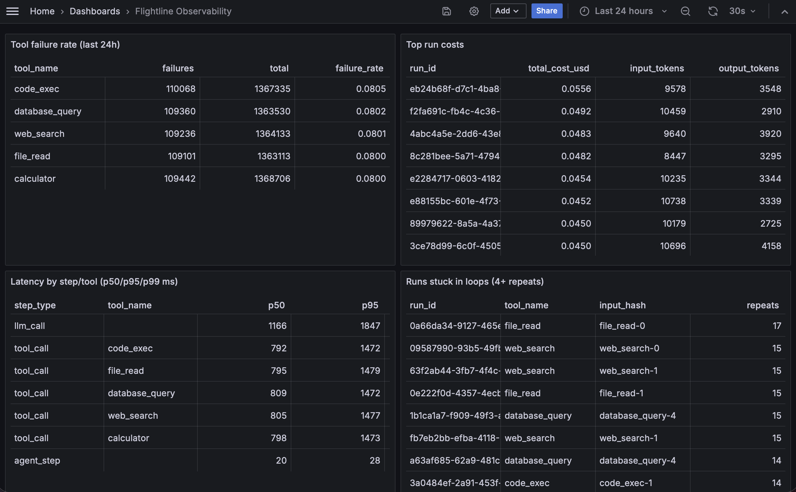

# flightline-observability

A self-hosted trace pipeline purpose-built for AI agents. Agents send spans for every LLM call and tool call to an ingest service; spans flow through a queue into ClickHouse; a query API and a Grafana dashboard answer the questions that actually matter when an agent misbehaves - which tools fail most, what each run costs, and which runs are stuck looping on the same tool call. Generic APM tools weren't built for this shape of data (nested tool calls, token costs, loop detection); this is.

## Quickstart

```sh
git clone https://github.com/jaykanakiya/flightline-observability

cd flightline-observability

docker compose up -d --build

make generate

open http://localhost:3000
```

If ports 3000 or 8081 are already taken locally, copy `.env.example` to `.env` and set `GRAFANA_PORT` / `API_PORT`.

To see a single real agent run instead of synthetic data:

```sh
cd agent
pip install -r requirements.txt
python agent.py
```

## Benchmark

Full results, methodology, and the exact reproduce command: [benchmarks/RESULTS.md](benchmarks/RESULTS.md).

| | |
|---|---|
| Sustained ingest (generator -> ingest -> Redpanda) | 286,243 spans/sec |
| Sustained consumer insert (Redpanda -> ClickHouse) | 89,027 spans/sec |
| End-to-end, 10.1M spans | ~112s (~90,313 spans/sec) |
| `tool-failures` / `run-costs` / `slow-steps` query (p50, at 10.6M rows) | 38ms / 125ms / 87ms |
| `loops` query (p50, at 10.6M rows) | 1.35s |

## Dashboard



*(add a screenshot of the Grafana dashboard here)*

## Design decisions

**A queue between ingest and storage.** Agents calling the ingest endpoint shouldn't notice or care whether ClickHouse is slow, down, or mid-migration. Redpanda decouples the two: ingest's only job is to validate and produce; the consumer absorbs backpressure from ClickHouse on its own schedule. It's also what makes the insert-after-commit pattern below possible.

**ClickHouse for storage.** The actual query shapes here - aggregate over millions of rows, group by tool/model/run, compute percentiles - are exactly what a columnar MergeTree engine is good at and what a row store (Postgres) or document store struggles with at this volume. 10.6M rows compressed to 977 MiB on disk against 3.23 GiB uncompressed (about 3.3x), and the three queries that align with the table's sort order stayed under 130ms at that row count.

**Batching strategy.** The consumer batches by whichever comes first: 10,000 spans or 1 second (`internal/batch`, tested independently of Kafka/ClickHouse). Offsets are only committed after `InsertSpans` succeeds; if the insert fails, the consumer process exits without committing, and Redpanda redelivers the same batch to the next instance. That's at-least-once delivery traded for simplicity - no custom retry/backoff logic, just "crash and let the queue replay."

**Loop detection.** A run is "stuck in a loop" when it calls the same tool with the same `input_hash` 4 or more times:

```sql
SELECT run_id, tool_name, input_hash, count() AS repeats
FROM spans
WHERE step_type = 'tool_call' AND input_hash != ''
GROUP BY run_id, tool_name, input_hash
HAVING repeats >= 4
```

This counts occurrences rather than requiring them to be consecutive - a run that calls the same tool with the same input 4+ times is stuck regardless of what else happens in between, and counting keeps the query a single `GROUP BY`/`HAVING` instead of a window-function pass looking for consecutive repeats.

## Hardest problem

The `loops` query. At 10.6M rows it runs at p50 1.35s / p95 2.7s, while the other three stats queries stay under 130ms at the same row count. The difference is the `spans` table's `ORDER BY (run_id, tool_name, start_time)`: `tool-failures` and `slow-steps` group by a couple of low-cardinality columns ClickHouse aggregates in one fast pass, and `run-costs` groups by `run_id` which happens to lead the sort key. `loops` groups by `(run_id, tool_name, input_hash)` - `input_hash` isn't in the sort key at all, so ClickHouse can't use the primary key to narrow the scan and has to aggregate over the whole table.

## Next steps

- **OTLP/HTTP ingestion.** The ingest service only accepts the project's own JSON span format today; adding an OTLP/HTTP endpoint using the OpenTelemetry GenAI semantic conventions would let it accept traces from existing OTel-instrumented agents without a custom SDK.
- **Faster loop detection at scale.** See "Hardest problem" above - a materialized view is the most promising option.
- **Replay.** Being able to re-run a stuck or failed run's spans through a debugger/visualizer, not just query them.
- **Multi-tenancy.** Spans currently have no tenant/project boundary; `agent_name` is just a label, not an access boundary.
- **Retention policies.** The schema has a 30-day TTL on `start_time`; making that configurable per-deployment instead of hardcoded in `init.sql`.
